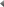
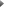
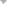

# Aero UI Icons

SVG icons in the style of the Windows 7 Aero interface: window controls, scroll buttons, dropdown arrows, slider thumbs and a loading spinner.

## Icons

The previews are scaled up 3×. The size column shows the actual size of each SVG.

### Window controls

| Preview | File | Size |
| :-: | --- | --- |
|  | [`minimize.svg`](minimize.svg) | 12 × 5 |
|  | [`maximize.svg`](maximize.svg) | 12 × 10 |
|  | [`restore.svg`](restore.svg) | 12 × 12 |
|  | [`close.svg`](close.svg) | 11 × 10 |
|  | [`help.svg`](help.svg) | 7.6 × 11.5 |

### Scroll buttons

| Preview | File | Size |
| :-: | --- | --- |
|  | [`button-up.svg`](button-up.svg) | 7 × 4 |
|  | [`button-down.svg`](button-down.svg) | 7 × 4 |
|  | [`button-left.svg`](button-left.svg) | 4 × 7 |
|  | [`button-right.svg`](button-right.svg) | 4 × 7 |

### Dropdown and search

| Preview | File | Size |
| :-: | --- | --- |
|  | [`dropdown-arrow.svg`](dropdown-arrow.svg) | 7 × 4 |
|  | [`dropdown-arrow-disabled.svg`](dropdown-arrow-disabled.svg) | 7 × 4 |
|  | [`search.svg`](search.svg) | 14 × 14 |

### Slider thumbs

| Normal | Hover | Active | Disabled | Size |
| :-: | :-: | :-: | :-: | --- |
|  [`slider-indicator.svg`](slider-indicator.svg) |  [`slider-indicator-hover.svg`](slider-indicator-hover.svg) |  [`slider-indicator-active.svg`](slider-indicator-active.svg) |  [`slider-indicator-disabled.svg`](slider-indicator-disabled.svg) | 10 × 18 |
|  [`slider-indicator-box.svg`](slider-indicator-box.svg) |  [`slider-indicator-box-hover.svg`](slider-indicator-box-hover.svg) |  [`slider-indicator-box-active.svg`](slider-indicator-box-active.svg) |  [`slider-indicator-box-disabled.svg`](slider-indicator-box-disabled.svg) | 10 × 18 |

### Spinner

| Preview | File | Size |
| :-: | --- | --- |
|  | [`spinner.svg`](spinner.svg) | 32 × 32 |

The spinner is animated with SMIL and rotates once every 1.05 s.

## Credits

Based on the icons from [7.css](https://github.com/khang-nd/7.css/tree/main/gui/icon) by [khang-nd](https://github.com/khang-nd), licensed under the [MIT License](https://github.com/khang-nd/7.css/blob/main/LICENSE).
