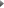
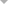

# Aero UI Icons

SVG icons in the style of the Windows 7 Aero interface: window controls, scroll buttons, arrows, a clipboard symbol, dropdown arrows, slider thumbs, a loading spinner, folders and a Control Panel icon.

## Installation

```sh
npm install aero-ui-icons
```

## Usage

The package works with any framework or none. Import an icon as an SVG string and put it in the DOM:

```js
import { close, spinner } from "aero-ui-icons";

button.innerHTML = close;
```

The export names are the file names in camelCase, so `slider-indicator-box-hover.svg` becomes `sliderIndicatorBoxHover`.

You can also import the SVG files directly. Your bundler turns them into URLs or components, depending on its config:

```js
import closeUrl from "aero-ui-icons/close.svg";
```

### CSS classes

Like an icon font, the stylesheet turns any element with a class into an icon:

```js
import "aero-ui-icons/icons.css";
```

```html
<span class="aero aero-close"></span>
```

The class names are the file names with an `aero-` prefix, so `slider-indicator-box-hover.svg` becomes `aero-slider-indicator-box-hover`. Icons are `1em` tall and scale with the `font-size`, and the width follows each icon's aspect ratio. They keep their gradients, so `color` doesn't change them.

## Icons

The previews are scaled up 3×, except for the arrows, symbols and shell icons. The size column shows the actual size of each SVG.

### Window controls

| Preview | File | Size |
| :-: | --- | --- |
|  | [`minimize.svg`](icons/minimize.svg) | 12 × 6 |
|  | [`maximize.svg`](icons/maximize.svg) | 12 × 10 |
|  | [`restore.svg`](icons/restore.svg) | 12 × 12 |
|  | [`close.svg`](icons/close.svg) | 12 × 10 |
|  | [`help.svg`](icons/help.svg) | 8 × 12 |

### Scroll buttons

| Preview | File | Size |
| :-: | --- | --- |
|  | [`button-up.svg`](icons/button-up.svg) | 8 × 4 |
|  | [`button-down.svg`](icons/button-down.svg) | 8 × 4 |
|  | [`button-left.svg`](icons/button-left.svg) | 4 × 8 |
|  | [`button-right.svg`](icons/button-right.svg) | 4 × 8 |

### Arrows

| Preview | File | Size |
| :-: | --- | --- |
|  | [`arrow-up.svg`](icons/arrow-up.svg) | 50 × 52 |
|  | [`arrow-down.svg`](icons/arrow-down.svg) | 50 × 52 |
|  | [`arrow-left.svg`](icons/arrow-left.svg) | 52 × 50 |
|  | [`arrow-right.svg`](icons/arrow-right.svg) | 52 × 50 |

The arrows are white, so they're meant for dark or colored backgrounds.

### Symbols

| Preview | File | Size |
| :-: | --- | --- |
|  | [`clipboard.svg`](icons/clipboard.svg) | 46 × 52 |

The symbols match the arrows and are white as well.

### Dropdown and search

| Preview | File | Size |
| :-: | --- | --- |
|  | [`dropdown-arrow.svg`](icons/dropdown-arrow.svg) | 8 × 4 |
|  | [`dropdown-arrow-disabled.svg`](icons/dropdown-arrow-disabled.svg) | 8 × 4 |
|  | [`search.svg`](icons/search.svg) | 14 × 14 |

### Slider thumbs

| Normal | Hover | Active | Disabled | Size |
| :-: | :-: | :-: | :-: | --- |
| <br>[`slider-indicator.svg`](icons/slider-indicator.svg) | <br>[`slider-indicator-hover.svg`](icons/slider-indicator-hover.svg) | <br>[`slider-indicator-active.svg`](icons/slider-indicator-active.svg) | <br>[`slider-indicator-disabled.svg`](icons/slider-indicator-disabled.svg) | 10 × 18 |
| <br>[`slider-indicator-box.svg`](icons/slider-indicator-box.svg) | <br>[`slider-indicator-box-hover.svg`](icons/slider-indicator-box-hover.svg) | <br>[`slider-indicator-box-active.svg`](icons/slider-indicator-box-active.svg) | <br>[`slider-indicator-box-disabled.svg`](icons/slider-indicator-box-disabled.svg) | 10 × 18 |

### Spinner

| Preview | File | Size |
| :-: | --- | --- |
|  | [`spinner.svg`](icons/spinner.svg) | 32 × 32 |

The spinner is animated with SMIL and rotates once every 1.05 s.

### Shell icons

| Preview | File | Size |
| :-: | --- | --- |
|  | [`folder.svg`](icons/folder.svg) | 48 × 48 |
|  | [`folder-open.svg`](icons/folder-open.svg) | 48 × 48 |
|  | [`folder-download.svg`](icons/folder-download.svg) | 48 × 48 |
|  | [`control-panel.svg`](icons/control-panel.svg) | 48 × 48 |

## Credits

Based on the icons from [7.css](https://github.com/khang-nd/7.css/tree/main/gui/icon) by [khang-nd](https://github.com/khang-nd), licensed under the [MIT License](https://github.com/khang-nd/7.css/blob/main/LICENSE).
